# AgriGate

### Which crops fit your farm today, and which will still fit in 2050?

**NASA Space Apps Challenge 2026 · *Field Shift: Adapting Farms with NASA Data***


AgriGate is a full-stack website backed by a **machine-learning model**. Pick any place in the 48 mainland United States and the crops you want to grow. AgriGate then tells you:

- **How likely each crop is to succeed there**, from a LightGBM model trained on NASA climate data, USDA and USGS soil data, and real USDA farm records for every US county
- **How your crops fit the soil**: nutrient balance (nitrogen, phosphorus, sulfur), soil pH fit, and a two-year rotation that starts with your primary crop
- **Where the climate is heading**: a linear-regression trend on 42 years of NASA data at your exact location, and how each crop's chance changes by 2050

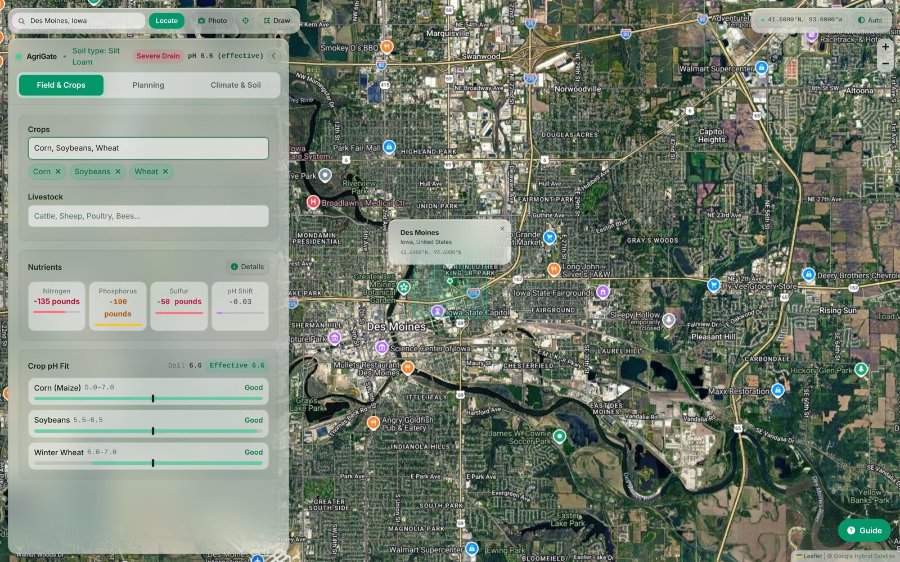

---

## Contents

1. [Run it on any computer](#run-it-on-any-computer)
2. [How it works](#how-it-works)
3. [Step 1: The data](#step-1-the-data)
4. [Step 2: The training table](#step-2-the-training-table)
5. [Step 3: Training the model](#step-3-training-the-model)
6. [Step 4: Testing it fairly (no overfitting)](#step-4-testing-it-fairly-no-overfitting)
7. [Results](#results)
8. [Looking ahead to 2050](#looking-ahead-to-2050)
9. [The website](#the-website)
10. [Project structure and API](#project-structure)
11. [Limitations](#limitations)
12. [Data sources](#data-sources)

---

## Run it on any computer

1. **Download:** click the green **Code** button above → **Download ZIP**, then unzip it.
2. **Start it:**
   - **Windows:** double-click `Start_AgriGate_Windows.bat`. If Python is missing, it installs it for you; then double-click the file once more.
   - **Mac:** right-click `Start_AgriGate_Mac.command` → **Open** (macOS asks you to confirm the first time). If Python is missing, it opens the download page.
   - **Linux / any terminal:**
     ```bash
     python3 -m pip install -r model/requirements.txt
     python3 start_agrigate.py
     ```
3. Your browser opens **http://127.0.0.1:8768/index.html** by itself, and the terminal says **`LightGBM model: loaded`**.

> The first start installs the model's libraries (LightGBM, pandas, NumPy, PyArrow), so it needs an internet connection. Live NASA climate data is also fetched from the internet.

---

## How it works

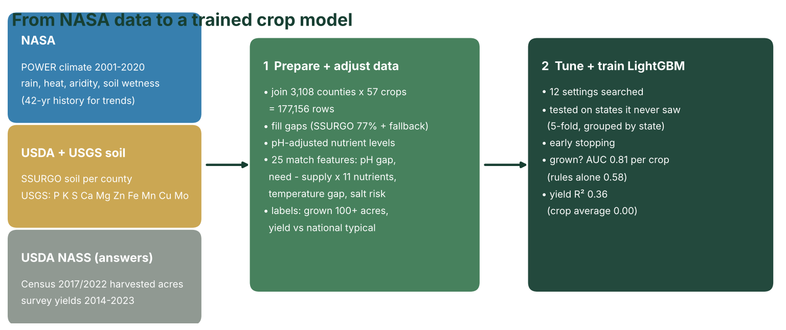

In one sentence: **we collected public climate and soil data for every US county, paired it with real records of which crops farmers grow there, and trained a model to learn the patterns.** The model can then judge any location, today or under a future climate.

| Step | What we did |
|---|---|
| **1. Collect** | Downloaded NASA climate, USDA soil, USGS nutrient and USDA farm-census data |
| **2. Build** | Joined everything into one training table: every county × every crop |
| **3. Train** | Trained a LightGBM model: 446 decision trees that learn from each other's mistakes |
| **4. Test** | Tested it on whole states it never saw, so it can't just memorise |
| **5. Project** | Extended NASA's climate trend to 2050 and asked the model again |
| **6. Serve** | A Python server loads the saved model; the website asks it for any location |

---

## Step 1: The data

All data is **free and public**.

| Source | What it gives us | How we used it |
|---|---|---|
| **NASA POWER** | Rain, air temperature, daily temperature range, root-zone soil wetness | 2001–2020 averages for every county (model input), plus 1984–2025 monthly data for climate trends |
| **USDA NRCS SSURGO** soil survey | Soil pH, organic matter, texture, salinity, drainage, water-holding capacity | Area-weighted average for each county, queried with SQL from Soil Data Access |
| **USGS** soil geochemistry (Data Series 801 / Open-File Report 2014-1082) | Soil nutrients: phosphorus, potassium, sulfur, calcium, magnesium, zinc, iron, manganese, copper, molybdenum | The 5 nearest survey sites to each county, weighted by distance |
| **USDA NASS** Census of Agriculture (2017, 2022) | Which crops each county really harvests, and yields (2014–2023) | **The answers the model learns from** |

**The answer key:** where America really grows its crops, according to the farm census.

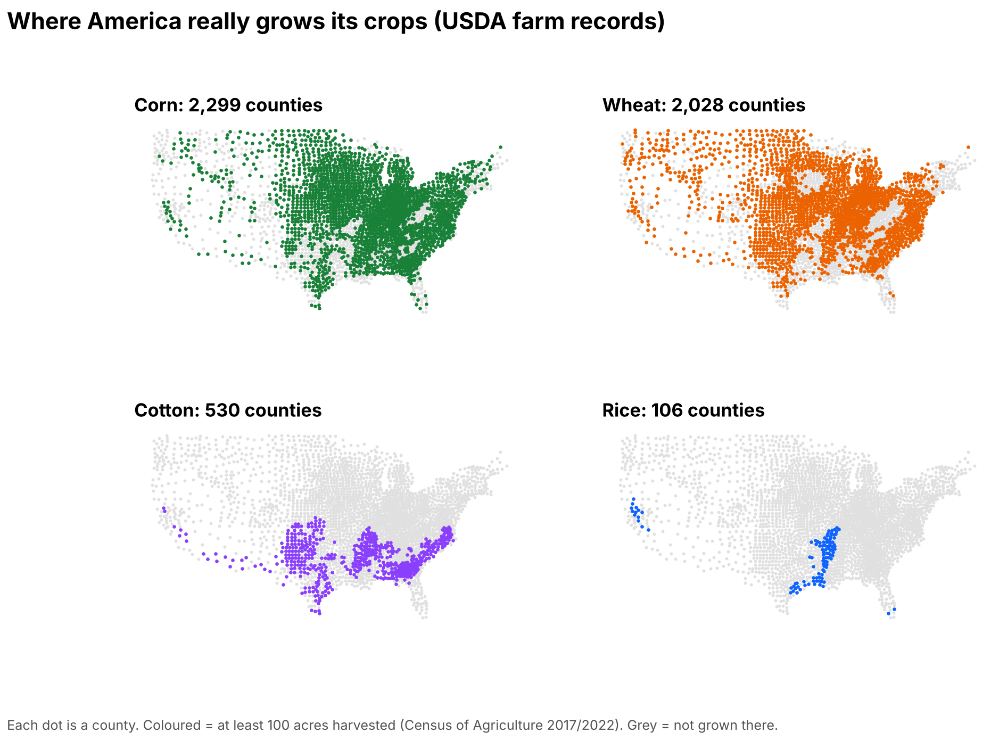

**What NASA tells us about every county:**

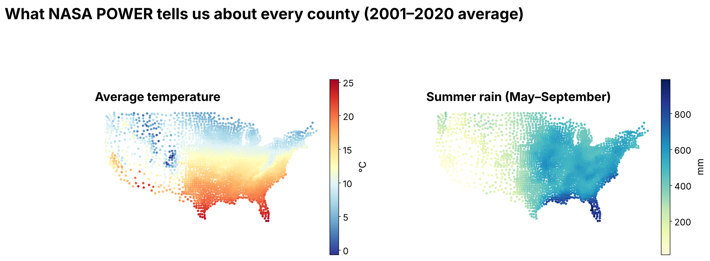

Compare the two sets of maps: cotton grows where it's **hot**, corn where summers are **wet**. The model learns links like these by itself, along with many more that are too complex to draw.

---

## Step 2: The training table

The scripts in [`training/`](training/) download, clean and join the data into **one table**:

- **80,808 rows**, one for every county × crop pair (3,108 counties × 26 crops)
- **94 clues per row** (the model's inputs), for example:
  - **Climate (NASA):** yearly and summer rain, average/warmest/coldest temperature, dry months, aridity, root-zone wetness
  - **Soil (USDA):** pH, organic matter, texture, salinity, drainage
  - **Nutrients (USGS):** 11 measurements, each also scored low/medium/high and lowered when the soil pH locks that nutrient up
  - **The crop's needs:** pH range, temperature range, rain needs, nutrient demand
  - **Match clues we built:** for example, how far the soil pH is from the crop's ideal, or rain ÷ the crop's minimum rain
- **1 answer per row:** *is this crop grown commercially here?* (at least 100 harvested acres in the census)

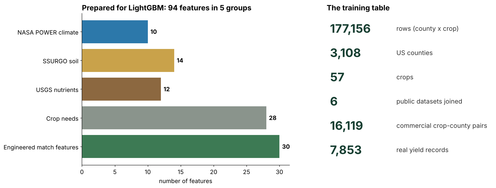

Three real rows from the table:

| County · crop | Summer rain | Avg. temperature | Soil pH | Phosphorus | Grown? |
|---|---|---|---|---|---|
| Polk, Iowa · corn | 541 mm | 10.1 °C | 6.5 | 976 mg/kg | Yes |
| Polk, Iowa · cotton | 541 mm | 10.1 °C | 6.5 | 976 mg/kg | No |
| Fresno, California · cotton | 44 mm | 14.6 °C | 6.3 | 511 mg/kg | Yes |

> Our hand-written soil rules say Polk County's soil is fine for cotton, yet nobody grows cotton there because it's too cold. **Rules alone miss things like this, which is why we train a model.** The rule's verdict becomes just one clue among the 94.

Before training, we checked that the data makes sense:

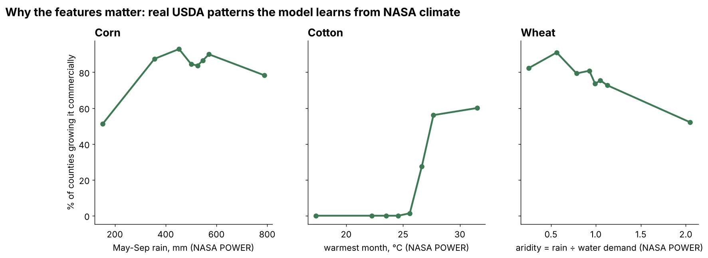

---

## Step 3: Training the model

### What is LightGBM?

LightGBM (**Light G**radient **B**oosting **M**achine) builds the model out of many small **decision trees**:

- A **decision tree** is a flowchart of yes/no questions, such as *"Is summer rain above 300 mm?"*
- Each path ends in a **leaf** with a score: positive means "probably grown", negative means "probably not".
- **Boosting:** trees are added one at a time, and each new tree is trained to fix the mistakes the earlier trees still make.
- The final answer adds up the scores from every tree and turns the total into a chance from 0% to 100%.

Nobody writes the questions: **the computer finds the best ones by studying the 80,808 rows.**

**Real trees from our trained model.** Early trees ask big questions (which crop is it?); later trees make small corrections:

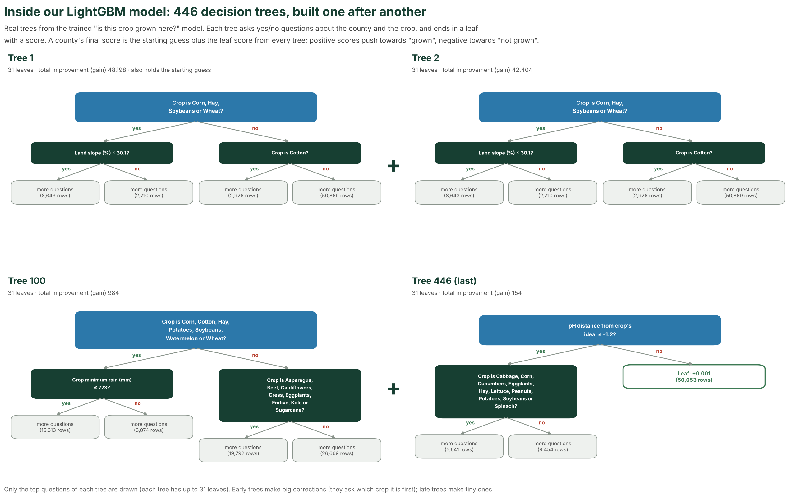

**Boosting in action:** real predictions built up tree by tree. After 1 tree, every example sits near the starting guess. By tree 446, corn in Iowa reaches 99% and cotton in Iowa reaches 0%, matching the farm census.

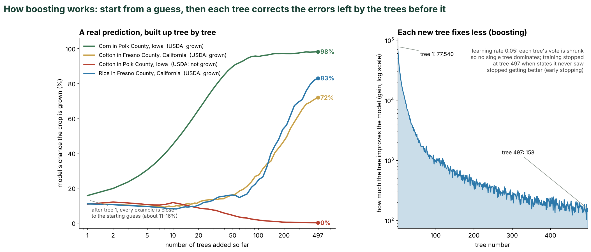

### Settings

```python
params = dict(objective="binary", learning_rate=0.03, num_leaves=31,
              min_data_in_leaf=50, feature_fraction=0.5)
```

| Setting | Value | Plain meaning |
|---|---|---|
| Learning rate | 0.03 | Each tree makes only a small correction |
| Leaves per tree | 31 | How detailed each tree can be |
| Rows per leaf (minimum) | 50 | No rule can be built from just a few counties |
| Clues per tree | 50% | Each tree sees a random half of the clues, so no single clue takes over |
| Trees | 446 | Chosen by early stopping (see below) |

We tried **12 different combinations** of settings, scored each one on hidden states only, and kept the best:

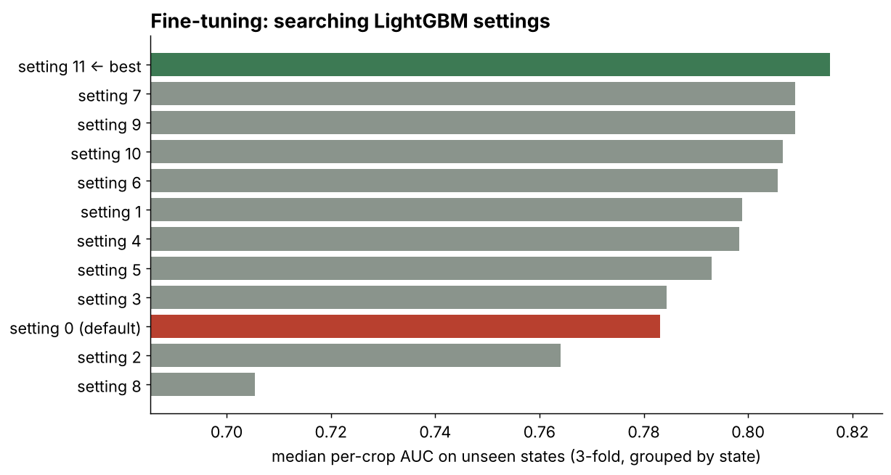

---

## Step 4: Testing it fairly (no overfitting)

**Overfitting** means a model memorises its training data instead of learning real patterns, like memorising the answers to a practice test instead of understanding the subject.

Neighbouring counties are almost identical, so testing on a county next door to one the model trained on would be like seeing the exam answers. Instead we **hide whole states**:

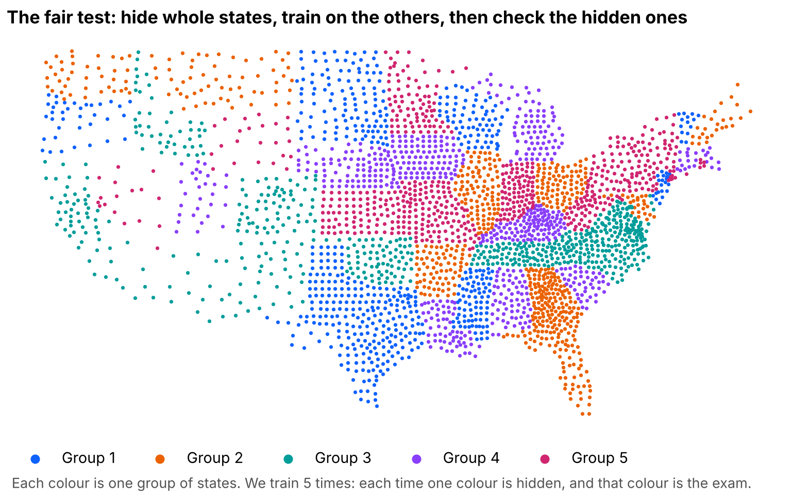

1. Split the states into 5 groups (the colours).
2. Train on 4 groups, then test on the hidden group.
3. Repeat 5 times, so every state is tested once while hidden.

This is **cross-validation grouped by state** (`GroupKFold`).

**Early stopping:** in the real training curve below, the error on the states the model trained on (grey) keeps falling toward zero, because it's starting to memorise. The error on hidden states (blue) levels off around 0.13 and then slowly gets worse. **We stop at 446 trees**, before memorising takes over.

<p align="center">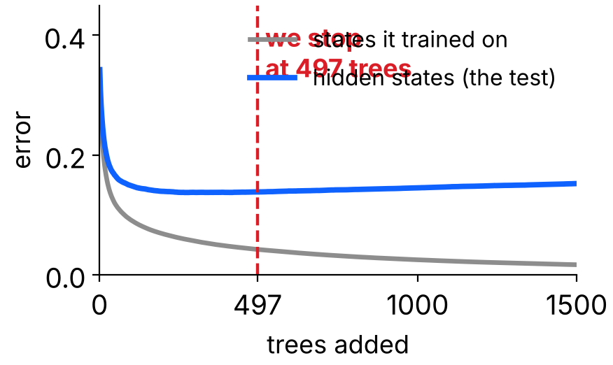</p>

---

## Results

All scores are measured **on states the model never saw during training**.

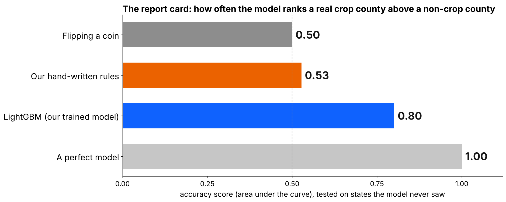

### What does 0.80 mean?

The score is the **AUC** (area under the curve). Take one county that really grows a crop and one that doesn't, and ask the model which is more likely to grow it:

| Score | Meaning |
|---|---|
| **1.00** | Always picks the right county (perfect) |
| **0.80** | **Our model:** picks the right one 80% of the time |
| **0.53** | Our hand-written rules: barely better than guessing |
| **0.50** | A coin flip: no skill at all |

We report the **median score per crop**. The overall score across all crops (0.975) looks better but is inflated, because most crops aren't grown in most counties, which makes "no" easy to guess.

| Model | Score per crop (median) | Yield R² |
|---|---|---|
| Hand-written rules | 0.53 | — |
| LightGBM (default settings) | 0.79 | 0.36 |
| **LightGBM (tuned)** | **0.80** | **0.36** |

A second LightGBM model predicts **harvest size (yield)**. It explains 36% of the differences between counties (R² 0.36), where simply using each crop's average explains 0%.

### Score for each crop

Strongest on big field crops: **peanuts 0.95, cotton 0.94, soybeans 0.92, sugar beets 0.92, rice 0.91, corn 0.85**. It's weaker on vegetables, which are grown commercially in only a few states, so there are few examples to learn from.

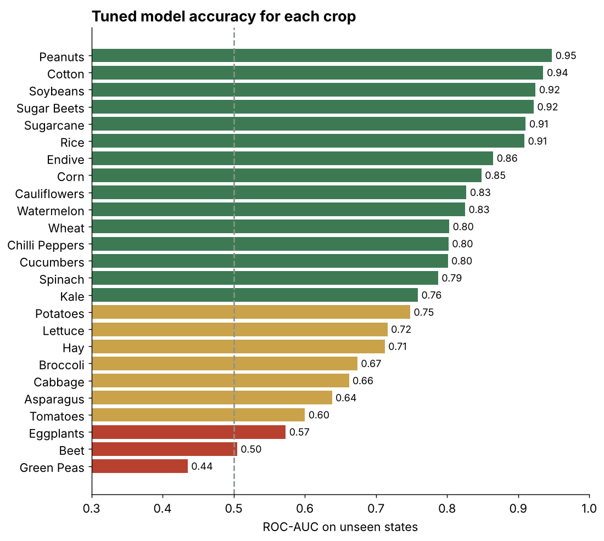

### Does it match reality?

The real USDA map of corn counties (left) next to the model's guess, where each state was guessed by a version of the model that never saw it (right). **The model found the Corn Belt by itself.**

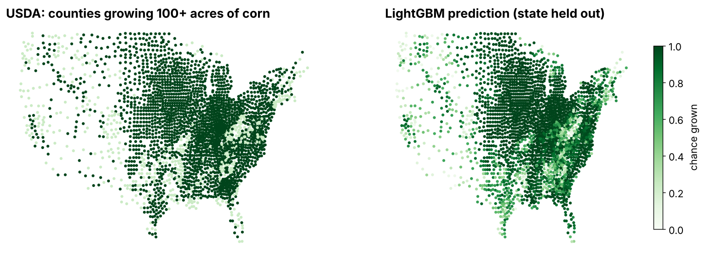

### What the model relies on

Among the information about a location, **NASA climate data carries 43%** of the model's decisions, the largest share of any source.

<p align="center">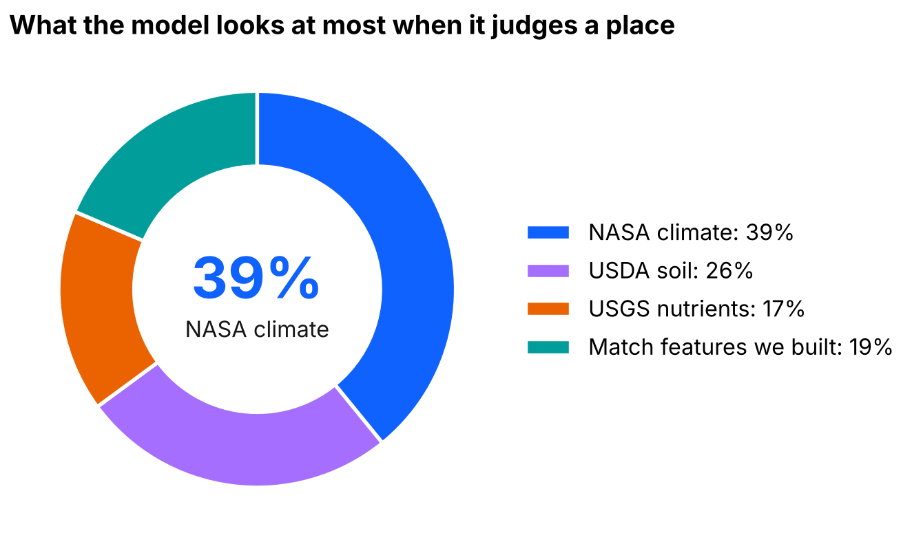</p>

---

## Looking ahead to 2050

1. Pull **NASA POWER monthly temperature and rain, 1984–2025**, for the chosen location.
2. Fit a **linear regression**: the straight line that best fits the yearly values.
3. Extend the line to **2050**.
4. Put the 2050 climate into the model's inputs and **ask the model again**.

**Example, Des Moines, Iowa:** warming of **+0.37 °C per decade** (R² 0.18; the years vary a lot around the trend) points to about **11.7 °C** by 2050. Rain shows no clear trend (R² 0.02).

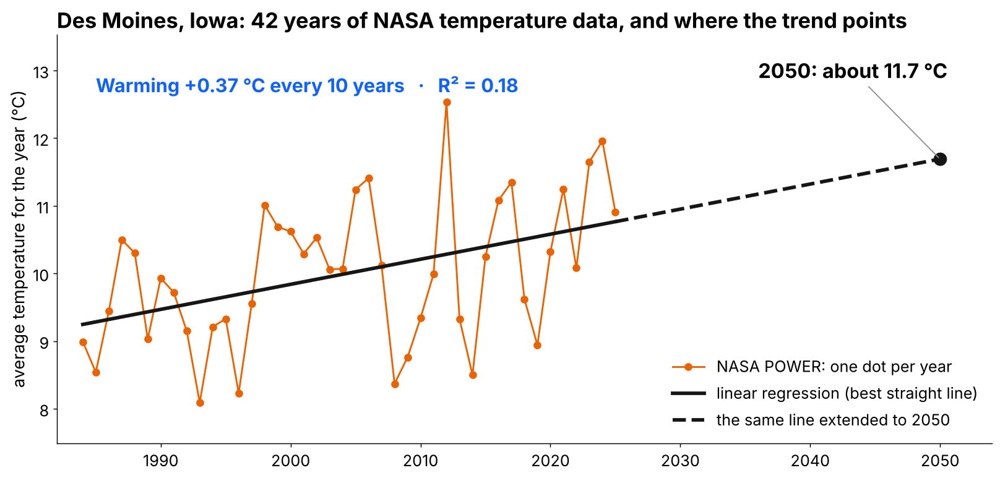

With that warmer climate (about +1.5 °C and 9% less rain), **wheat rises from 51% to 94%**, while corn and soybeans stay near the top:

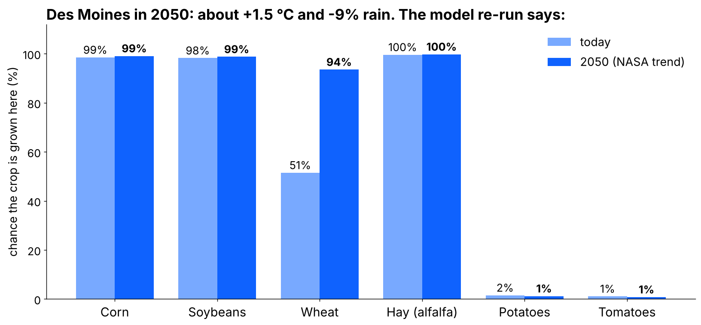

> This is a trend extrapolation of observed NASA data, not a full climate-model scenario.

---

## The website

| Climate trend at your field | Your crops in 2050 |
|---|---|
| 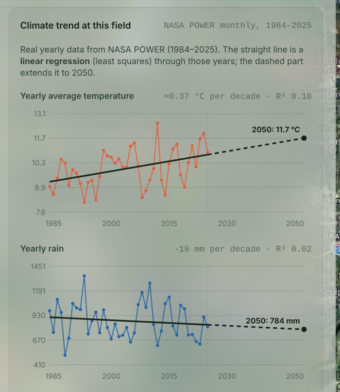 | 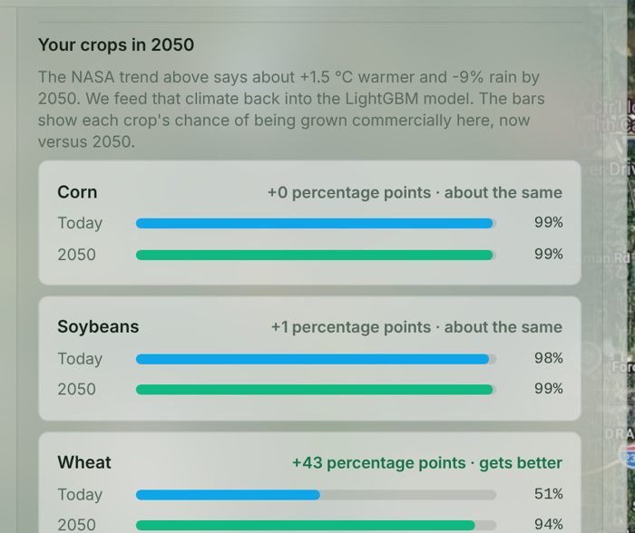 |

- **Field & Crops:** search a place or draw your field, then pick your crops. The first crop is your **primary crop** (click the star on another crop to change it). You also see the nutrient balance and soil pH fit.
- **Planning:** a two-year rotation that starts with your primary crop, and additional plants ranked by the LightGBM model.
- **Climate & Soil:** NASA climate trend charts with the regression line to 2050, and how each of your crops' chances changes.
- **Guide:** a five-step walkthrough that opens on your first visit.

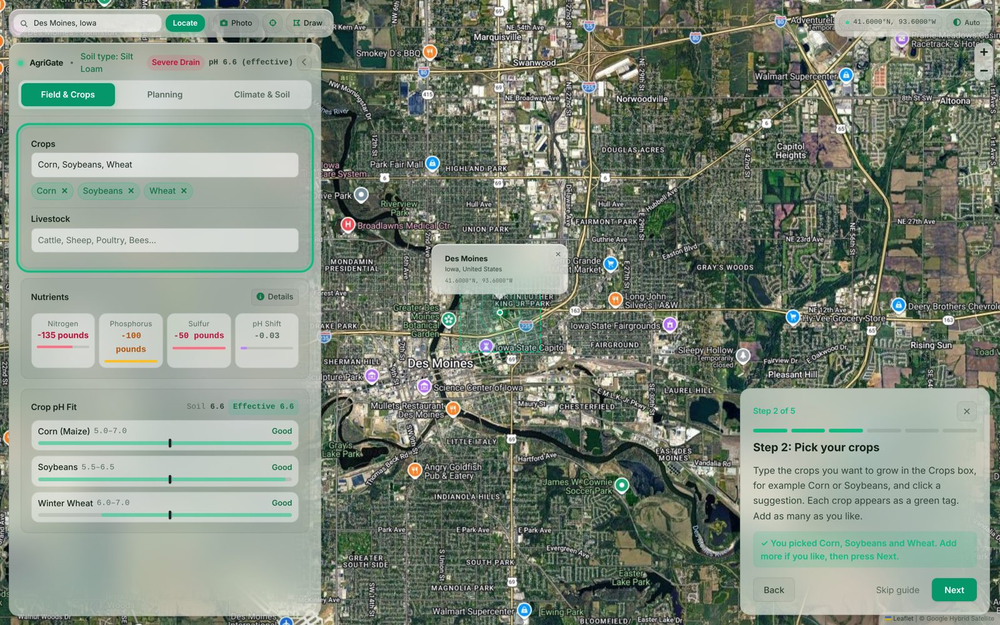

---

## Project structure

```
AgriGate/
├── index.html                    The website (HTML, Tailwind CSS, JavaScript, Leaflet map)
├── start_agrigate.py             Python server: serves the site and the model API
├── Start_AgriGate_Windows.bat    One-click start for Windows
├── Start_AgriGate_Mac.command    One-click start for Mac
├── render.yaml                   Settings for optional hosting on Render
├── model/
│   ├── agrigate_model.py         Loads the models; predict, climate trend, 2050 re-run
│   ├── models/                   The trained LightGBM models (crop chance, yield)
│   ├── data/                     The training table and feature list
│   └── requirements.txt          Python libraries the model needs
├── training/
│   ├── build_training_data.py    Downloads and joins NASA, USDA and USGS data
│   ├── ssurgo_county.py          SQL queries to the USDA soil database
│   ├── tune_and_figures.py       Tuning, fair testing, final training, graphs
│   ├── visualize_lightgbm.py     The tree and boosting graphs
│   └── figures/                  All result graphs
├── data/                         Map data, crop database and helper scripts for the website
├── assets/                       Images and model graphs shown on the website
└── docs/                         Screenshots for this README
```

### Model API

The server answers these requests with JSON:

| Request | Returns |
|---|---|
| `/api/model/predict?lat=41.6&lon=-93.6` | Each crop's chance of being grown, plus predicted yield |
| `/api/model/climate?lat=41.6&lon=-93.6&until=2050` | NASA POWER yearly data and the linear regression |
| `/api/model/future?lat=41.6&lon=-93.6&year=2050` | The model re-run on the projected climate |
| `/api/model/info` | Model accuracy and training data |

### Retrain the model

The finished training table is included, so you can retrain without downloading anything:

```bash
cp model/data/county_crop_train.parquet model/data/feature_columns.json training/
pip install -r model/requirements.txt scikit-learn matplotlib
python3 training/tune_and_figures.py
```

`training/build_training_data.py` shows how the table was built from the raw NASA, USDA and USGS downloads. The raw files aren't included because of their size.

---

## Limitations

- **County level, not field level:** soil and climate are county averages, so two farms in the same county get the same ranking.
- **"Grown" isn't the same as "can grow":** harvest records also reflect markets, irrigation and tradition. The model learns where crops *are* grown commercially.
- **The 2050 view is a trend, not a forecast:** it extends observed NASA data in a straight line, and rain trends are weak.
- **Weaker for vegetables**, which are grown commercially in only a few states.
- **Mainland United States only:** that's where the training answers come from.

*AgriGate is a support tool. It doesn't replace a soil test, local experts or a farmer's own judgment.*

---

## Data sources

- **NASA POWER** (Prediction Of Worldwide Energy Resources), NASA Langley Research Center: https://power.larc.nasa.gov
- **USDA NRCS Soil Survey Geographic Database (SSURGO)** via Soil Data Access: https://sdmdataaccess.sc.egov.usda.gov
- **USDA NASS Quick Stats**, Census of Agriculture 2017 and 2022: https://quickstats.nass.usda.gov
- **USGS** Geochemical and Mineralogical Data for Soils of the Conterminous United States (Data Series 801; Open-File Report 2014-1082)
- **ISRIC SoilGrids** (live soil readings on the website): https://soilgrids.org
- **FAO Harmonized World Soil Database** (fills counties missing USDA soil data)
- **US Census Bureau Gazetteer** (county locations)

Built for the **NASA Space Apps Challenge 2026**.
